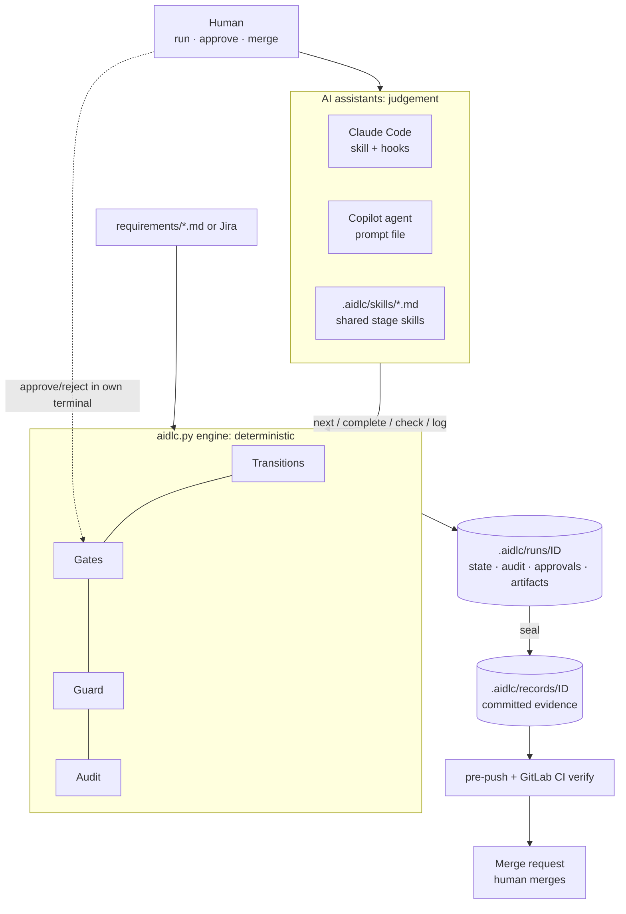
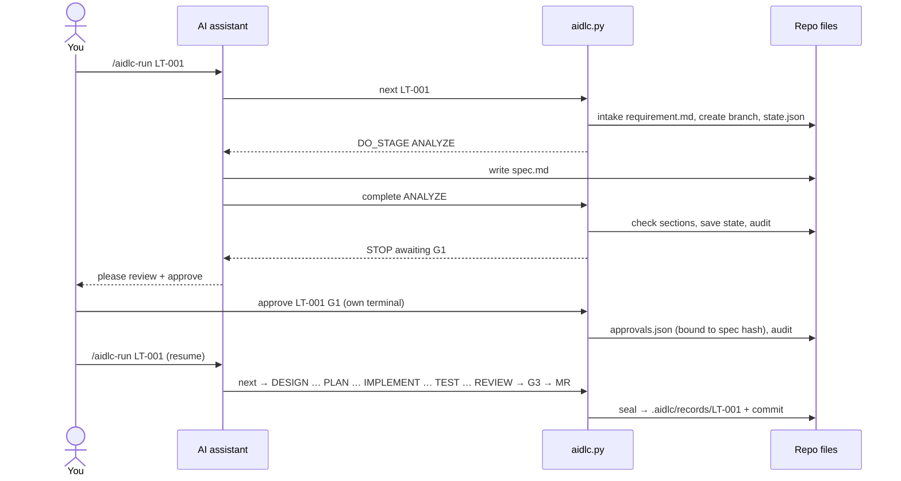

# AIDLC architecture

## Design principle
**Judgement goes to the AI. Rules go to deterministic code.** An LLM following a prompt will eventually
skip a step. So every rule that must hold, on both Claude and Copilot, is enforced by `aidlc.py`, hooks or CI,
and never only by a prompt.

## Layers


## Orchestration: driver vs brain
| Part | Where | Does |
|---|---|---|
| Loop driver | `aidlc-run` skill (Claude) / `aidlc-run.prompt.md` (Copilot), both pointing at `.aidlc/skills/orchestrator.md` | Calls `next`, does the stage work, calls `complete`, and stops when told |
| Brain | `aidlc.py next` / `complete` | Decides the stage, validates output, opens gates, logs, resumes |

Nothing runs in the background. The loop moves while an assistant session is open. When a gate is approved,
`/aidlc-run <ID>` resumes from `state.json`. (A headless `claude -p "/aidlc-run LT-001"` triggered from CI is a
possible extension and needs no design change.)

## Sequence (one requirement)


## Engine responsibilities (`tools/aidlc/aidlc.py`)
1. **State**: the only writer of `state.json` (atomic write + replace).
2. **Transitions**: fixed lifecycle. Gates G1/G2/G3 can only be passed by `approve`.
3. **Stage exit checks**: required sections, numbered ACs, plan JSON and AC coverage, one tagged commit per task,
   tests run by the engine itself, the guardrail scan, and no commits after G3.
4. **Approvals**: human-only (TTY required, refused inside Claude Code), bound to the artifact hash (G3 also to HEAD),
   and revoked automatically if the artifact or commit changes.
5. **Audit log**: append-only JSONL, SHA-256 hash chain, secrets redacted, actor = `ai:<client>/<model>` | `human:<git user>` | `engine`.
6. **Guard**: scope fence for Claude hooks. The same rules are re-checked from the git diff for every client.
7. **Resume**: idempotent `next`. Re-validates the branch, approvals and requirement source. Derives task progress from
   `[ID][Tn]` commit tags.
8. **Concurrency and safety**: per-run lock with expiry, failed-attempt budget → BLOCKED, `HALT` kill switch.
9. **Seal and verify**: copies the run into `.aidlc/records/<ID>/`, commits it, and `verify` re-checks everything in CI.

## Data written per run
```
.aidlc/runs/LT-001/                (git-ignored, local working state)
  state.json   approvals.json   audit.jsonl   .lock
  artifacts/ requirement.md spec.md design.md plan.md implementation-notes.md
             test-report.md test-output.log guardrail-report.json review.md mr.md feedback.md
.aidlc/records/LT-001/             (same files, sealed and committed on the feature branch)
```
Why two places: the live state must survive branch switches (so it's git-ignored), while the evidence must travel with
the MR (so it's committed).

## Claude vs Copilot
| Concern | Claude Code | Copilot (VS Code agent) |
|---|---|---|
| Entry | `.claude/skills/aidlc-run` | `.github/prompts/aidlc-run.prompt.md` |
| Rules | `CLAUDE.md` → `AGENTS.md` | `.github/copilot-instructions.md` → `AGENTS.md` |
| Pre-edit blocking | PreToolUse hook `aidlc.py guard` | none: caught at `complete` and in CI |
| Tool-level logging | PostToolUse hook `aidlc.py hook-log` | stage events + git diff only |
| Human-only commands | `permissions.deny` + engine refuses when `CLAUDECODE` is set + TTY check | terminal auto-approve disabled (`.vscode/settings.json`) + TTY check |
